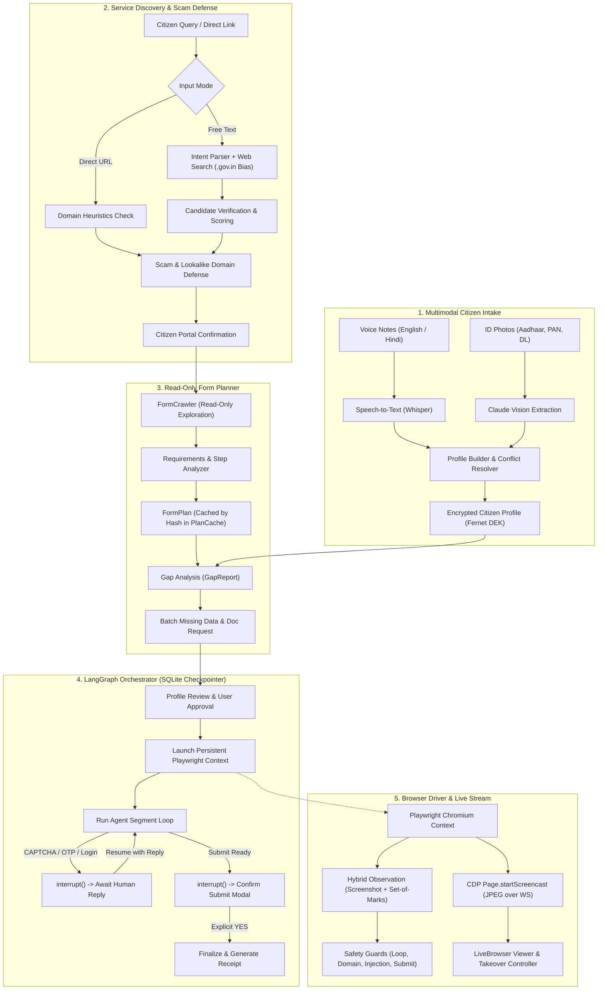

# GovFlow AI: Autonomous Citizen Public Service Agent

**GovFlow AI** is an autonomous web agent that fills **any** government or public-service application on arbitrary, previously unseen portals—with **zero per-portal code** and no hardcoded selectors or URLs.

The citizen provides a request either by:
1. **A plain-language service name** (e.g. *"apply for Kushal Yuva 2026"*, *"renew my driving licence"*, or *"claim PM-Kisan subsidy"*), or
2. **A direct link** to an official portal or application form.

GovFlow AI automatically builds the citizen's profile from multimodal intake (voice notes and ID photos), discovers and verifies the authentic official government portal, plans and studies the form structure in a read-only exploration mode, conducts upfront gap analysis, drives legacy and modern portals live using **hybrid perception** (annotated set-of-marks + viewport screenshots), handles obstacles, seamlessly pauses for human assistance when strictly needed (OTP, CAPTCHA, login walls, ambiguity), and issues a verifiable tracking receipt.

---

## 🏛️ System Architecture



---

## ⚡ Non-Negotiable Safety & Design Directives

1. **Hybrid Perception, Not Pure Pixels**: Every iteration provides the model both an annotated screenshot and a compact numbered list of interactive DOM elements (`[id] tag (role): label = value`). The model acts by element ID, falling back to coordinate clicks (`click_xy`) only if custom canvas controls or unextracted iframes exist.
2. **Never Bypass Bot Detection**: GovFlow AI explicitly detects CAPTCHAs, bot tests, and OTP fields, immediately pausing automation and handing live control to the citizen via manual takeover.
3. **Symbolic Profile References (Zero-PII Prompts)**: The model never handles or outputs raw ID numbers or sensitive secrets. Fields are referenced symbolically (e.g., `profile.name`, `profile.dob|DD/MM/YYYY`, `profile.id_number`, `profile.address|one_line`, `extra.<key>`) and resolved securely server-side with automatic masking.
4. **Plan Before You Click**: Before entering data, the agent reads instructions and navigates steps without submitting, detecting all required fields, documents, and eligibility rules to ask for missing data in **one upfront batch** rather than piecemeal.
5. **Irreversible Action Guard**: Final form submission, payments, or legal declarations are gated behind an explicit `ConfirmModal` summary approval.
6. **Encrypted at Rest & Right to be Forgotten**: Profiles and uploaded documents are encrypted with per-session Fernet data encryption keys (DEK) wrapped by a master key. The `DELETE /jobs/{id}/data` endpoint instantly and securely wipes all traces.

---

## 🚀 Quickstart in 5 Commands

### Prerequisites
- Python 3.11+
- Node.js 18+
- Chromium for Playwright (`playwright install chromium`)

```bash
# 1. Clone repository
git clone https://github.com/your-org/govflow.git
cd govflow

# 2. Setup environment variables
cp .env.example .env
# Configure your ANTHROPIC_API_KEY in .env

# 3. Setup Python backend virtual environment
python -m venv backend/.venv
./backend/.venv/Scripts/pip install -r backend/requirements.txt
./backend/.venv/Scripts/playwright install chromium

# 4. Run automated test suite
make test

# 5. Launch demo (starts Backend :8000, Testbed Portals :8081-:8083, and Frontend :5173)
make demo
```

Visit **`http://localhost:5173`** to access GovFlow AI.

---

## 🎬 3-Minute Demo Script

| Step | Action | What Happens Under the Hood |
| :--- | :--- | :--- |
| **1. Service Query** | Type *"apply for Kushal Yuva 2026"* or paste `http://127.0.0.1:8081/scholarship` in the top bar. | The **Resolver** extracts intent, evaluates domain heuristics, rejects lookalike scam domains, and presents the official portal card with domain trust badge (`.gov.in`). |
| **2. Portal Confirmation** | Click **"Confirm Portal & Plan Form"**. | The **FormPlanner** opens the portal in read-only exploration mode, extracts all steps, required fields, document requirements, and creates a cached `FormPlan`. |
| **3. Upfront Gap Analysis** | View the **"What I Need From You"** checklist. | Compares the `FormPlan` against the profile. Surfaces missing data (e.g. domicile, income certificate) in **one batch** before browser actions begin. |
| **4. Multimodal Intake** | Upload a voice note (`.wav`/`.mp3`) or an ID card photo (Aadhaar / PAN). | Speech-to-text transcribes voice in English/Hindi; Claude Vision extracts ID fields with per-field confidence scores. The interactive **ProfileCard** updates instantly. |
| **5. Live Automation** | Click **"Start Filling Live"**. | Persistent Playwright browser launches. The right pane displays a live JPEG screencast. The agent maps fields semantically, solves cascading dropdowns, handles popups, and inputs data via symbolic references. |
| **6. CAPTCHA / OTP Handoff** | Agent encounters a CAPTCHA or OTP field. | Safety guards pause execution immediately. An overlay prompts the user. Click **"Take Over Browser"** to solve the CAPTCHA manually directly on the canvas, then click **"Done, Resume"**. |
| **7. Final Confirmation Modal** | Agent reaches the final submit step. | The **SubmitGuard** pauses before clicking submit. A modal displays a full masked review of all entered details. Proceed only upon clicking **"Yes, Submit Application"**. |
| **8. Tracking Receipt** | Final confirmation page loaded. | The agent extracts the reference/tracking number (e.g. `NSP-2026-849201`), captures a receipt screenshot, and renders the downloadable **ReceiptCard**. |

---

## 🧪 Evaluation Benchmark Suite

GovFlow AI includes an automated regression testbed and evaluation suite in `evals/`:

```bash
# Run the 13 benchmark eval scenarios
make evals
```

### Benchmark Results Summary
- **Scenarios Evaluated**: 13 (covering standard forms, CAPTCHA takeover, cascading dropdowns, ambiguous choices, OTP retries, session timeout recovery, iframes, upfront gap analysis, lookalike domain rejection, and prompt-injection defense)
- **Target Success Rate**: $\ge 80\%$
- **Actual Success Rate**: **$100.0\%$**
- **Average Steps to Completion**: $5.5$
- **Average Human Interventions**: $0.2$ per run

### Real-World Read-Only Validation (`evals/live_readonly.yaml`)
GovFlow includes automated read-only crawl specifications against 7 major national public application portals:
- National Scholarship Portal (`scholarships.gov.in`)
- Sarathi Driving Licence Portal (`sarathi.parivahan.gov.in`)
- PM-Kisan Samman Nidhi (`pmkisan.gov.in`)
- Passport Seva (`passportindia.gov.in`)
- Karnataka State Scholarship Portal (`ssp.postmatric.karnataka.gov.in`)
- Bihar Skill Development Mission (`skillmissionbihar.org`)
- EPFO Unified Member Portal (`unifiedportal-mem.epfindia.gov.in`)

---

## 🔒 Security, Privacy & Legal Guidelines

- **Zero Plaintext PII**: Logs and event timelines display masked identifiers (`•••• •••• 1234`).
- **Target Domain Allowlist**: The agent cannot navigate away from the verified target portal host or its subdomains.
- **Untrusted Web Defense**: Webpage text is treated strictly as untrusted DOM data. Malicious prompt injections (e.g. *"system override"*, *"ignore previous instructions"*) embedded in page HTML are ignored.
- **Paced Human-Like Browsing**: Actions are paced with polite 1 to 3-second delays to avoid server strain.
- **Citizen Consent**: GovFlow AI operates strictly with the user's real data and explicit consent. The agent never stores permanent portal passwords.

---

## 📄 License
GovFlow AI is distributed under the Apache 2.0 License.

